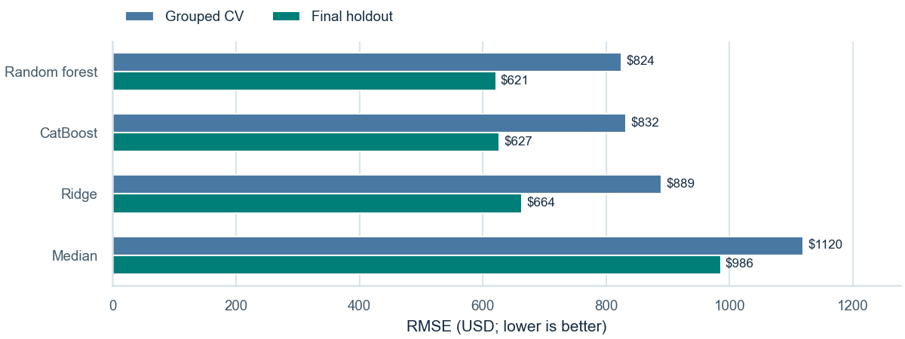

# Rent Prediction Lab

Can a model estimate monthly asking rent for an apartment in a geographic cell whose rents were not used to train it? This Python case study was inspired by a prior R random-forest competition entry. It uses a public UCI data snapshot, not the competition files, and does not reproduce or claim a Kaggle leaderboard score. AI assisted with the implementation and documentation.

[Six-page report](outputs/rent-prediction-case-study.pdf) · [Interview guide](INTERVIEW.md) · [Run summary and parameters](outputs/summary.json) · [Ranked configurations](outputs/cv_ranked.csv) · [Search parameters by trial](outputs/search_space.json)



## What won

| Model | Pooled CV RMSE | Holdout RMSE | Holdout MAE |
|---|---:|---:|---:|
| **Tuned random forest** | **$824.50** | **$621.26** | $308.10 |
| Tuned CatBoost | $831.90 | $627.24 | **$298.64** |
| Ridge | $889.21 | $663.83 | $353.43 |
| Training median | $1,120.03 | $985.61 | $488.15 |

The forest won on the prespecified RMSE metric, but the holdout gap was only $5.98. The paired 95% cell-bootstrap interval for CatBoost minus forest RMSE was −$61 to +$69, so this split did not establish a clear winner across cells. CatBoost had the lower average absolute error. Tuning improved CatBoost’s CV RMSE from $848.69 to $831.90; removing the rent comparables at the chosen settings improved it further to $820.13. That ablation was exploratory and was **not** scored on the final holdout. The forest’s largest misses were in the $3,500+ band (35 rows, $2,305 MAE).

## Data and leakage controls

One row is one classified listing, not a building or a signed lease. The 2019 UCI *Apartment for Rent Classified* 10K snapshot contains U.S. listings.[1] The loader checks SHA-256 for both the 7z member and CSV. Retain monthly USD apartment listings with finite positive price and size, and deduplicate IDs. Retain unusual prices; RMSE reflects their effect. Use structured fields: size, beds, baths, coordinates, location, amenities and listing metadata. Exclude `price_display`, free text that may contain the asking price, raw address, ID, and timestamp. See `outputs/summary.json` for missing values and the row audit.

A geographic split assigns each coordinate pair to a 0.02° grid cell. Rows with missing coordinates share a group by city/state. Hold out around 20% of *cells* using a fixed seed; the row percentage can differ. Tune on four non-overlapping validation sets in the remaining data using GroupKFold.[3] This tests transfer into held-out cells, not transfer to completely new cities or future observations. Nearby listings straddling cell borders and reposts across cells can still overlap geographically.

The R workflow took a good idea (location-level rent) and computed it before splitting, so validation labels could influence validation features. The Python version computes city rent, city rent/ft², state rent, and city evidence counts inside each split. Training rows exclude **all rents in their own cell**. Validation and test use **only labels from their corresponding training set**. City estimates shrink toward state averages, and states shrink toward the global average. An unseen city automatically falls back to its state or overall average.

## Model selection and diagnostics

| Candidate | Search |
|---|---|
| Training median | No tuning |
| Ridge regression | Fixed alpha=10; fold-local median imputation, scaling and one-hot encoding |
| Random forest | 6 combinations of feature fraction and minimum leaf size, 180 trees each |
| CatBoost | 9 combinations of depth, learning rate, leaf penalty and split randomness, scored at 150, 300, 500 and 750 trees |

CatBoost supports categorical inputs directly.[2] This implementation uses plain boosting (not the paper’s ordered boosting mode). Each fit is reused at four tree-count checkpoints through CatBoost's prediction API.[5] Model selection uses the smallest **pooled out-of-fold dollar RMSE**, computed as `sqrt(sum squared errors / total validation rows)`. The chosen configuration for each family is then fitted on all development rows and scored on the same held-out cells. Validation rankings from a tuning search can be optimistic; the holdout is the post-selection check.

Ablations keep CatBoost settings fixed and compare direct-dollar fitting with a log target, and comparables versus no comparables. They isolate the changes *at those settings* rather than retuning each variant. The report also includes holdout MAE by price band and market familiarity, a paired cell bootstrap interval for the RMSE gap, and mean absolute SHAP values on a 300-row holdout sample.[4] That bootstrap reflects test-cell sampling for the fitted models; it does not include refit uncertainty. SHAP describes predictions, not causal rent drivers.

## Reproduce

Python 3.11 (verified), from a clean virtual environment:

```bash
python -m pip install -r requirements.txt
python -m unittest discover -s tests -v
python study.py
python verify.py
python report.py
python predict.py examples/listings.csv
```

The full search is CPU-only and can take several minutes. The first run downloads the public snapshot. `data/` holds local-only prediction rows, raw data, and the CatBoost model. `predict.py` rebuilds the same development-only comparable features and loads the fitted CatBoost model for a demo CSV. It is not a prediction service or a current valuation. `verify.py` checks the reported holdout metrics against independent Python calculations and reconciles CV scores against the raw per-fold table. `report.py` uses the saved outputs from `study.py` and regenerates all eight PNGs and the PDF.

This is a model benchmark on historical asking prices. It is not a current rent estimator, appraisal, or automated pricing tool. Validate on newer data and more challenging whole-city splits before considering deployment.

## Sources

[1] https://archive.ics.uci.edu/dataset/555/apartment%2Bfor%2Brent%2Bclassified — UCI (2019) Apartment for Rent Classified, DOI 10.24432/C5X623
[2] https://proceedings.neurips.cc/paper/2018/hash/14491b756b3a51daac41c24863285549-Abstract.html — Prokhorenkova et al. (2018), CatBoost: unbiased boosting with categorical features
[3] https://scikit-learn.org/1.6/modules/generated/sklearn.model_selection.GroupKFold.html — scikit-learn 1.6: GroupKFold
[4] https://catboost.ai/docs/en/concepts/shap-values — CatBoost documentation: SHAP values
[5] https://catboost.ai/docs/en/concepts/python-reference_catboostregressor_predict — CatBoost documentation: prediction with a subset of trees
